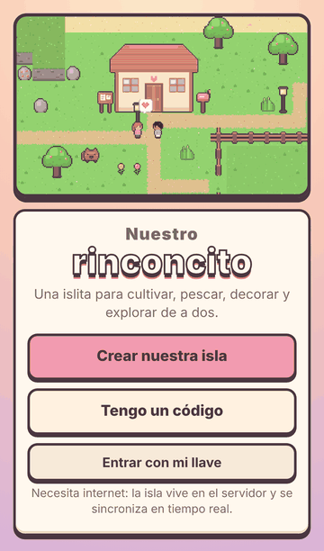
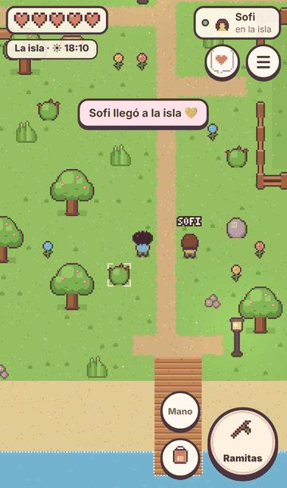
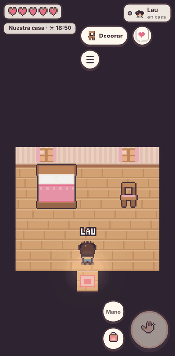
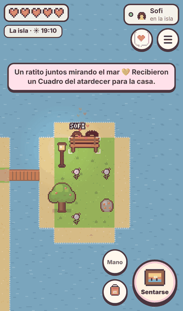
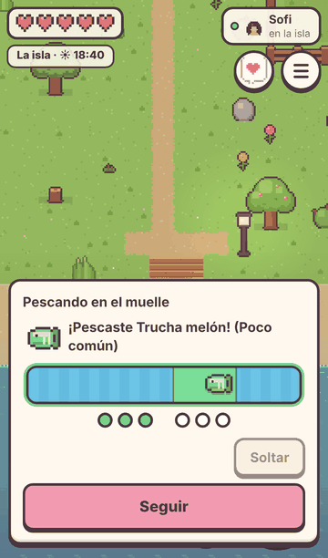
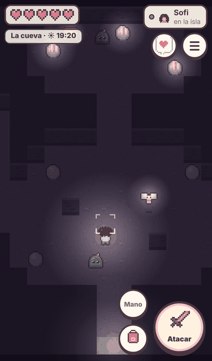
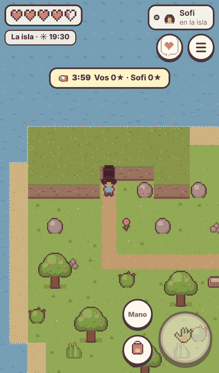
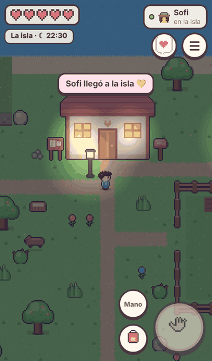

# Nuestro rinconcito 🏝️💛

Un juego tierno para dos: llegan a una islita y construyen su hogar juntos. Cultivan, pescan, juntan materiales, decoran la casa, exploran una cueva con criaturas simpáticas, cuidan a un carpincho y se dejan regalos en el buzón. Es **cooperativo**, con desafíos amistosos de 3–4 minutos, y está pensado para partidas de 10 a 20 minutos desde el celular.

<p align="center">
  
  
  
  
</p>
<p align="center">
  
  
  
  
</p>

- **Multijugador real**: cada uno juega desde su celular, el servidor es la autoridad y guarda todo.
- **PWA instalable** (Android y iPhone), sin publicidad, sin compras, sin energía ni castigos por no entrar.
- Arte pixel, música y sonidos **100 % originales**, generados por código en este proyecto.

---

## Qué se puede hacer

| | |
|---|---|
| 🏠 **Casa compartida** | Interior con muebles que se colocan en lugares válidos (no bloquean la puerta ni se superponen), cuadros en la pared y dos ampliaciones. |
| 🌱 **Huerta** | Preparar la tierra, plantar, regar y cosechar rabanitos, frutillas y calabazas. Los cultivos **nunca mueren**: si nadie riega, esperan. |
| 🌳 **Recolección** | Árboles, rocas, arbustos, pasto, piedritas y flores que reaparecen solos a los pocos minutos. |
| 🔨 **Fabricación** | Herramientas (hacha, pico, caña, espada, pico de cobre), muebles, comida y semillas. |
| 🎣 **Pesca** | Minijuego táctil corto con 5 peces de 4 rarezas; el muelle y el mirador dan peces más raros. |
| 🕯️ **Cueva** | Minerales, 3 cofres con tesoros (cada uno abre el suyo), Musguitos y Polillines, combate simple. Si te desmayás, despertás en casa **sin perder nada**. |
| 🐹 **Carpincho compartido** | Le ponen nombre, lo miman y le dan de comer; si lo cuidan, trae regalitos. |
| 💌 **Buzón** | Regalos y cartitas con nota, aunque la otra persona no esté conectada. |
| 🧑‍🎨 **Personalización** | Nombre, piel, peinado, color de pelo, remera y pantalón (y sombreros ganados en desafíos). |
| 🤝 **Objetivos compartidos** | Reparar el puente al mirador y ampliar la casa dos veces, aportando materiales entre los dos. |
| 🏆 **Desafíos amistosos** | El pez más raro · Carrera de minerales · Cosecha relámpago. Reglas y tiempo en pantalla, premio para los dos y un sombrero para quien gana. Nadie puede robar ni romper lo del otro. |
| 🌙 **Día y noche** | Un día dura 24 minutos; de noche se encienden las farolas y las ventanas. |

## Cómo se juega

- **Caminar**: apoyá el dedo en la mitad izquierda de la pantalla (aparece un joystick donde lo apoyes).
- **Botón grande**: hace lo que corresponda a lo que tenés enfrente (talar, picar, regar, plantar, cosechar, pescar, abrir, mimar, sentarse…). Mantenelo apretado para seguir talando o picando.
- **Mano**: elegís qué semilla plantar o qué comida darle al carpincho.
- **Mochila / menú (☰)**: inventario, fabricar, proyectos, desafíos, la isla (código, diario, llave personal) y ajustes de sonido.
- En la compu también anda con teclado: flechas/WASD, Espacio para la acción, `I` para la mochila.

---

## Probarlo en tu compu (5 minutos)

Necesitás [Node.js 22](https://nodejs.org/) o más nuevo.

```bash
git clone https://github.com/unicorniotoxico/nuestro-rinconcito.git
cd nuestro-rinconcito
npm install
npm start
```

Abrí <http://localhost:3000>. Para probar de a dos en la misma compu, abrí una segunda ventana **en modo incógnito** (así es "otra persona").

Desde dos celulares en la **misma red Wi-Fi** podés entrar a `http://IP-DE-TU-PC:3000` (por ejemplo `http://192.168.0.15:3000`). Así se juega bien, pero para **instalarlo como app** hace falta HTTPS: usá una de las opciones de abajo.

---

## Publicarlo para jugar desde cualquier lado

El juego necesita un servidor que esté prendido (Node.js + WebSocket) y un lugar donde guardar las islas. Tres caminos, de más fácil a más "propio":

### Opción A — Gratis y todo desde el celular: Render + Supabase

1. **Supabase** (la base de datos): creá una cuenta en <https://supabase.com>, un proyecto nuevo (plan Free) y en **SQL Editor** ejecutá:

   ```sql
   create table if not exists islands (
     id text primary key,
     data jsonb not null,
     updated_at timestamptz not null default now()
   );
   alter table islands enable row level security;
   ```

   Después, en **Project Settings → API**, copiá la **Project URL** y la **secret key** (`sb_secret_...`; en proyectos viejos se llama `service_role`). Esa clave es secreta: va solo en el servidor.

2. **Render** (el servidor): tocá este botón, conectá tu GitHub y pegá los dos datos cuando te los pida.

   [](https://render.com/deploy?repo=https://github.com/unicorniotoxico/nuestro-rinconcito)

   Al terminar te da una dirección tipo `https://nuestro-rinconcito.onrender.com`. Esa es la que abren los dos celulares.

> En el plan gratis, Render "duerme" el servidor si nadie entra por 15 minutos: la primera vez que entren después puede tardar ~1 minuto en despertar (el juego muestra "Conectando…"). Las islas no se pierden porque viven en Supabase. Supabase pausa los proyectos gratis después de una semana sin uso; se reactivan desde su panel y los datos siguen ahí.

### Opción B — Servidor propio (por ejemplo Oracle Cloud Free + DuckDNS)

En una VM con Ubuntu:

```bash
sudo apt install -y nodejs npm   # o instalá Node 22 desde nodesource
git clone https://github.com/unicorniotoxico/nuestro-rinconcito.git && cd nuestro-rinconcito
npm ci --omit=dev
cp .env.example .env              # ajustá DATA_DIR, TRUST_PROXY=1
sudo cp deploy/rinconcito.service /etc/systemd/system/ && sudo systemctl enable --now rinconcito
```

Para HTTPS, apuntá un dominio (por ejemplo uno gratis de [DuckDNS](https://www.duckdns.org/)) a la IP de la VM, abrí los puertos 80 y 443 y usá [Caddy](https://caddyserver.com/) con `deploy/Caddyfile.example`: saca el certificado solo.

Con Docker:

```bash
docker build -t rinconcito .
docker run -d --name rinconcito -p 3000:3000 -v rinconcito-data:/data --restart unless-stopped rinconcito
```

### Opción C — Desde tu PC con un túnel (para probar rápido)

```bash
npm start
# en otra terminal (https://developers.cloudflare.com/cloudflare-one/connections/connect-networks/downloads/)
cloudflared tunnel --url http://localhost:3000
```

Te da una dirección `https://algo.trycloudflare.com` con HTTPS que funciona desde cualquier celular mientras tu PC esté prendida. Cambia cada vez que lo abrís.

### Configuración

Todas las opciones se pasan por variables de entorno (o un archivo `.env`; ver [`.env.example`](.env.example)):

| Variable | Para qué | Por defecto |
|---|---|---|
| `PORT`, `HOST` | Dónde escucha el servidor | `3000`, `0.0.0.0` |
| `STORAGE` | `file` (archivos) o `supabase` | `file` |
| `DATA_DIR` | Carpeta de las islas con `STORAGE=file` | `./data` |
| `SUPABASE_URL`, `SUPABASE_SERVICE_KEY`, `SUPABASE_TABLE` | Con `STORAGE=supabase` | — , — , `islands` |
| `TRUST_PROXY` | `1` si hay un proxy delante (Render, Caddy, Cloudflare) | `0` |
| `ALLOWED_ORIGINS` | Dominios extra permitidos para el WebSocket | el mismo dominio |
| `MAX_ISLANDS`, `CREATE_PER_HOUR`, `JOIN_TRIES_PER_10MIN` | Límites anti-abuso | `500`, `6`, `20` |

---

## Jugar desde dos celulares

La guía paso a paso (crear la isla, invitar, instalar como app, volver a entrar, qué hacer si se corta) está en **[docs/GUIA-DOS-CELULARES.md](docs/GUIA-DOS-CELULARES.md)**.

Resumen: uno toca **Crear nuestra isla** y le comparte el **código** (o el enlace) al otro, que toca **Unirme**. El código sirve una sola vez. Cada celular guarda su **llave personal**; con ella se vuelve a entrar como uno mismo (Menú → Isla → Tu llave personal).

## Cómo está hecho

- **Servidor**: Node.js + [`ws`](https://github.com/websockets/ws). Es la autoridad: valida cada acción (distancia, herramientas, inventario, reglas), las aplica de a una y guarda en archivos atómicos o en Supabase.
- **Cliente**: HTML + Canvas 2D + JavaScript sin frameworks ni compilación. Resolución interna baja con escalado entero (nítido y liviano para celulares modestos).
- **Arte y sonido**: sprites pixel dibujados por código (`public/js/sprites.js`), música y efectos con WebAudio (`public/js/audio.js`).

Más detalle (sincronización, anti-duplicación, guardado y seguridad) en **[docs/ARQUITECTURA.md](docs/ARQUITECTURA.md)**.

## Pruebas

```bash
npm test            # 37 pruebas: servidor con dos clientes reales, mundo, guardado, Supabase y seguridad
npm run test:e2e    # recorrido completo con DOS navegadores (iPhone + Android emulados) y capturas
                    # (la primera vez: npx playwright install chromium)
```

Qué está probado, qué no y las limitaciones conocidas: **[docs/PRUEBAS.md](docs/PRUEBAS.md)**.

## Estructura

```
server/          servidor (index.js, hub.js, game/island.js = reglas, store/ = guardado)
shared/          datos y mapas que usan servidor y cliente (recetas, cultivos, peces, mapa…)
public/          la PWA: index.html, css/, js/ (render, sprites, ui, audio…), manifest y service worker
test/            pruebas automáticas (node --test) y e2e/ (Playwright con dos navegadores)
deploy/          ejemplos de systemd y Caddy
docs/            guías y capturas
```

## Licencia

Código bajo licencia MIT (ver [LICENSE](LICENSE)). El arte y la música son parte del código y se comparten igual.
